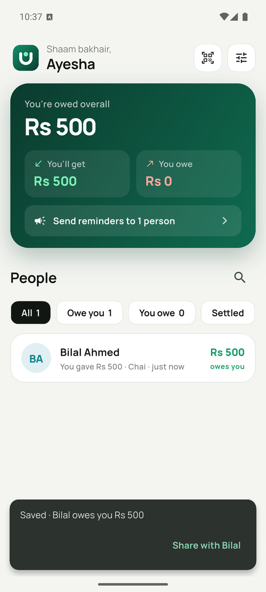
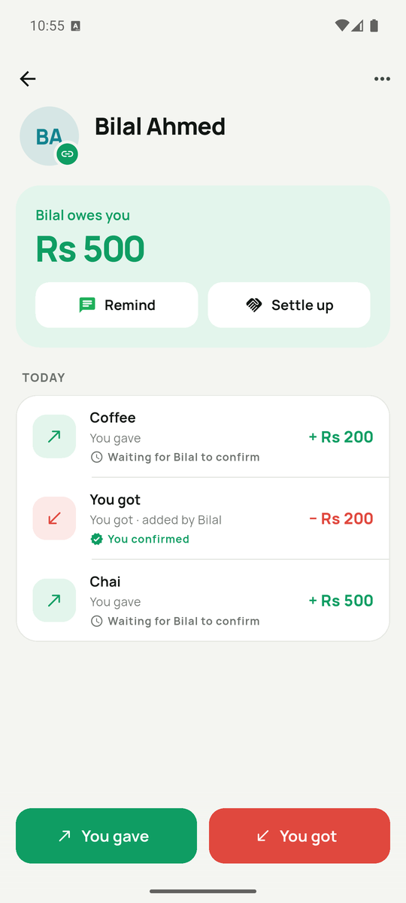
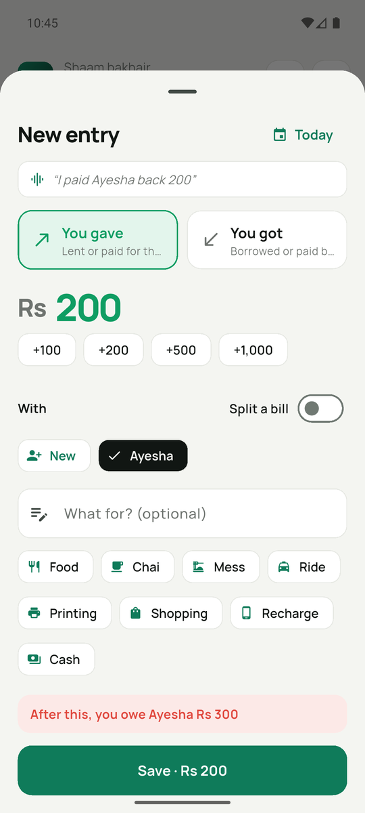
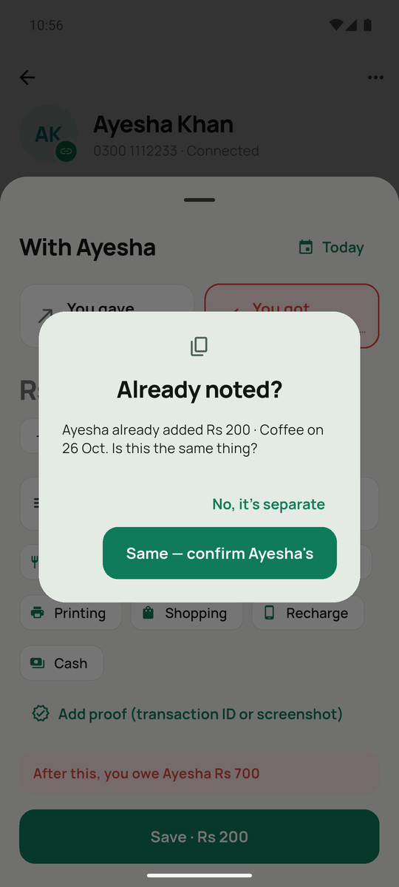

  

<h1 align="center">Udhaar</h1>

  <b>Hisaab-kitaab, without the awkward “yaar, woh paise?”</b> 
  A free Android app for university students to keep track of who owes whom.

  <a href="https://github.com/udhaar40-app/udhaar/releases/latest/download/Udhaar.apk"><b>⬇ Download Udhaar for Android (22 MB)</b></a>
  &nbsp;·&nbsp;
  <a href="https://github.com/udhaar40-app/udhaar/releases/latest">Release notes</a>

  
  
  
  

## What it does

- **Add in two taps, or just say it** — *“Ali owes me 500 for biryani”*,
  *“I borrowed 2000 from Sara”*, *“maine Bilal ko 1200 diye”*. English and Roman Urdu.
- **Shared hisaab** — send your friend a private link on WhatsApp (or let them
  scan your QR). After that, both phones show the same entries, live.
- **Confirm or flag** — every entry your friend adds shows *Correct / Not right*.
  Payments can carry the transaction ID and a screenshot as proof.
- **No double counting** — if you both log the same Rs 200 coffee, Udhaar asks
  “Already noted?” and counts it once.
- **Friendly reminders** — one tap sends a WhatsApp reminder listing what each
  amount was for, plus your Easypaisa / JazzCash number. A weekly summary
  reminds everyone too.
- **Split bills, settle up, works offline, dark mode.** Free, no ads.

## Install

1. Download **[Udhaar.apk](https://github.com/udhaar40-app/udhaar/releases/latest/download/Udhaar.apk)**
   on your Android phone (Android 6.0+).
   Very old phone? Use [Udhaar-older-phones.apk](https://github.com/udhaar40-app/udhaar/releases/latest/download/Udhaar-older-phones.apk).
2. Open the file. If Android asks, allow installing from your browser / WhatsApp.
   Android may warn that the app isn't from the Play Store — that's expected for apps shared directly.
3. Open Udhaar → **Continue with Google** (or try it first without an account).

## Privacy

Only you and the friend you share a hisaab with can see it. Your phone number is
shown only to people you share a hisaab with. Udhaar has no ads and no trackers.
